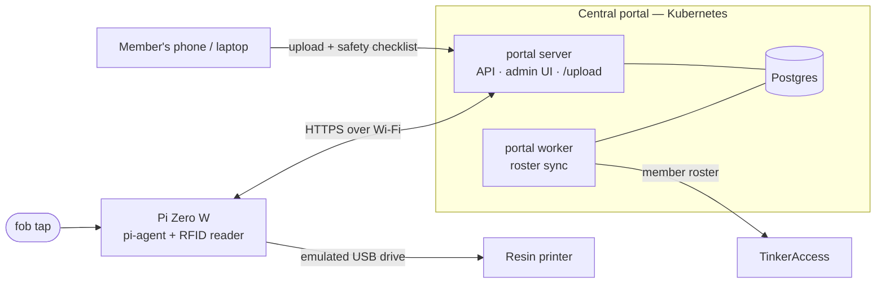

# Resin Print Portal

Controlled access to TinkerMill's resin printers, none of which have networking
of their own. Members upload sliced files to a central portal. At the printer,
a tap of their RFID fob loads the file onto the printer, through a Raspberry Pi
that poses as a USB flash drive. The portal decides who may print on what.

## How it works

1. **Upload.** A member opens the portal's `/upload` page, picks a printer,
   enters their name, attaches the sliced file, and confirms the printer's
   safety checklist. The portal checks that they're an active member certified
   on that printer, reads the print time out of the file, and holds it.
2. **Tap.** At the printer, the member taps their fob on the reader. The Pi
   asks the portal whether this fob may print here; if so, it downloads the
   held file and puts it on the drive the printer sees. Where the optional
   indicator is fitted, a green light and a beep mean it's loaded and red means
   it was refused; the Pi's status page on the LAN shows the same.
3. **Print.** The member starts the print from the printer's own screen.

Being at the printer is what releases a print. Every check, upload, and tap is
recorded in an audit log.



- **The portal owns the rules.** Certifications, per-printer settings and
  safety checklists, print jobs, and the audit log live in its database, managed
  from one admin UI.
- **TinkerAccess owns membership.** The worker syncs the member roster, with
  fob codes and active/inactive status, from TinkerAccess every few minutes. A
  member who lapses there is refused at the printer from the next sync on.
- **The Pi holds nothing.** It reads fobs, relays decisions, and writes one
  file to the drive. It keeps no member data and can be reflashed at any time.
  New Pis register themselves with the portal, and an admin approves each one
  once. Software updates for the Pis are pushed out from the portal.

## Documentation

| Guide | Covers |
|---|---|
| [Development](docs/development.md) | Building, running the whole system locally with a fake TinkerAccess, tests |
| [Deployment](docs/deployment.md) | Release images, installing and upgrading the portal with Helm, updating the Pi fleet, operations |
| [Pi provisioning](docs/pi-provisioning.md) | Flashing and bringing up a printer's Pi with `provision-sd.sh`, approval, troubleshooting |
| [Hardware](docs/hardware.md) | Parts list, wiring diagram, supported printers |
| [Configuration](docs/configuration.md) | Every environment variable and Helm value |
| [On-hardware tests](hw-tests/README.md) | Validating a real Pi and printer |
| [Reference](docs/reference/) | TinkerAccess API notes |

## Quick start

On Linux, with Go and Docker:

```bash
make deps                                                # check your toolchain
make run-db                                              # throwaway Postgres
make fake-tinkeraccess CODE=CAFE1234 NAME="Test Member"  # fake roster (own terminal)
make run ADMIN_PASSWORD=letmein                          # portal on :8080 (own terminal)
make run-worker                                          # roster sync (own terminal)
```

Then sign in at <http://localhost:8080/admin/login> as `captain` / `letmein`.
[docs/development.md](docs/development.md#running-the-whole-system-locally)
walks through the rest: creating a printer, uploading, and simulating a tap.

## Repository layout

```
cmd/
  portal/               central service: server | worker | migrate
  pi-agent/             the agent on each printer's Pi (static ARMv6 binary)
  fake-tinkeraccess/    stand-in member roster for local development
internal/
  server/               HTTP: Pi API, upload page, admin UI, status API
  store/                Postgres data layer
  worker/               TinkerAccess roster sync
  tinkeraccess/         TinkerAccess client
  piagent/              the agent: tap handling, portal client, self-update
  rfid/                 RDM6300 / EM4100 fob reader driver
  indicator/            LED and buzzer feedback
  gadget/               writes files onto the emulated USB drive
  sliced/               reads print time and target machine from sliced files
  fobcode/              fob ID format normalisation
  slack/                optional Slack notifications
  config/, buildinfo/   environment configuration, version stamping
db/migrations/          SQL migrations, embedded in the portal binary
web/                    admin UI templates and styles, embedded
build/Dockerfile        the portal image (bundles the Pi agent)
deploy/helm/            Helm chart for the portal
provisioning/           SD-card provisioning for new Pis
pi/                     the agent's systemd unit and installer
usb-refresh.sh          puts one file on the emulated drive (installed on the Pi)
piusb-gadget.service    loads the emulated drive at boot (installed on the Pi)
hw-tests/               on-hardware test scripts and manual checklist
scripts/                developer tools: dependency check, tap simulator
docs/                   guides; docs/archive/ holds superseded design notes
```

## License

MIT. See [LICENSE](LICENSE).
