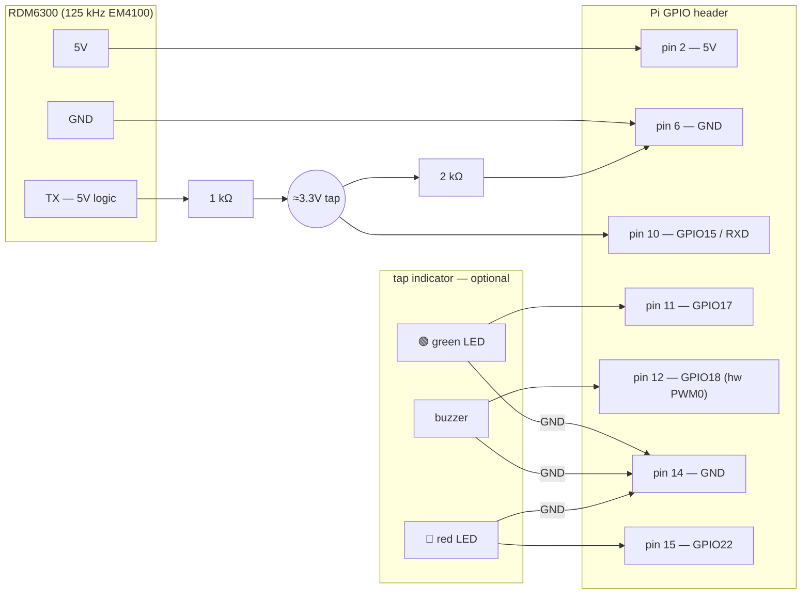

# Hardware

One Raspberry Pi per printer. The Pi presents itself to the printer as a USB
flash drive, reads members' RFID fobs, and optionally gives tap feedback with
two LEDs and a buzzer.

## Bill of materials (per printer)

| Part | Notes |
|---|---|
| **Raspberry Pi Zero W** | Fleet standard. A Zero 2 W also works (the first unit, `resin`, is one). Other models aren't tested. |
| microSD card, **8 GB or larger** | The USB drive image takes 1 GiB; the OS takes the rest. |
| Micro-USB data cable | Printer's USB-A port → the Pi's micro-USB port labelled **USB** (the inner one). Must be a data cable, not charge-only. |
| **RDM6300** 125 kHz RFID reader, with antenna coil | Required. TinkerMill fobs are 125 kHz EM4100; 13.56 MHz readers (MFRC522 etc.) can't read them. The common blue board ships with the coil attached. |
| 1 kΩ + 2 kΩ resistors | Required. Voltage divider on the reader's TX line. Any 1:2 pair works (10 kΩ + 20 kΩ is fine). |
| Green LED + red LED, each with a ~330 Ω resistor | Optional tap feedback. |
| Bare 2-pin piezo disc | Optional tap feedback. Driven directly from a GPIO, no transistor. |

## Power and USB

The Pi is powered **by the printer**, through the same cable it uses for
data. Use the port labelled **USB** — the outer **PWR** port has no data lines
on any Zero model, and the printer will never see the drive.

Consequences worth knowing:

- The Pi only runs while the printer is switched on.
- Every time the printer is switched off, the Pi loses power without a
  shutdown. The system is built for this: the agent holds no local state
  beyond its portal credentials, and the drive image is rewritten for every
  print.
- One Pi serves exactly one printer. A USB gadget can't be shared between
  hosts.

## Wiring

All connections are on the Pi's 40-pin header, using fixed pins. There is
nothing to configure in software.

### Fob reader (required)

| RDM6300 pin | Connects to | Pi physical pin |
|---|---|---|
| 5V | 5V | 2 |
| GND | GND | 6 |
| TX | **through the divider** → GPIO15 / RXD | 10 |

The reader's TX line is 5 V logic and the Pi's GPIOs are 3.3 V only — **never
connect TX straight to the Pi.** Wire 1 kΩ from TX to a junction, 2 kΩ from that
junction to GND, and take the junction to pin 10. That divides 5 V down to
≈3.3 V. The reader's RX pin is unused; it only ever transmits.

### Tap feedback (optional)

| Component | Connects to | Pi physical pin |
|---|---|---|
| Green LED anode (via ~330 Ω) | GPIO17 | 11 |
| Piezo buzzer, one leg | GPIO18 (hardware PWM0) | 12 |
| Red LED anode (via ~330 Ω) | GPIO22 | 15 |
| Both LED cathodes + the buzzer's other leg | GND | 14 |

Green plus a short beep means a tap just loaded a print. Red means the tap was
denied or the load failed. A Pi with none of this wired up behaves identically,
it just doesn't light up. The agent logs one warning at startup and carries on.

### Diagram



The reader (pins 2, 6, 10) and the indicator (pins 11, 12, 14, 15) share no
pins, so you can wire and test them separately.

### Checking the reader

On a provisioned Pi, stop the agent so it releases the serial port, then run
the built-in probe and tap a fob:

```bash
sudo systemctl stop resin-pi-agent
sudo pi-agent -probe
sudo systemctl start resin-pi-agent
```

The probe tells you which of three states you're in:

| Probe output | Meaning |
|---|---|
| No bytes at all | Wiring, power, or the UART isn't enabled. Check pin 10 and that `/dev/serial0` exists. |
| Bytes that never pass the checksum | Wrong baud, TX/RX swapped, or a bad divider. |
| A decoded tag ID | Working. |

A 13.56 MHz card or fob will never show up. That's expected, not a fault.

## Supported printers

The printer just sees a USB drive with one file on it, so anything that reads
sliced files from a FAT32 USB stick should work. These have been tested:

| Printer | File formats | Reads files from the Pi |
|---|---|---|
| Anycubic Photon Mono M7 Pro | `.pwsz`, `.pm7`, `.pm7m` | Verified (lists and opens) |
| Elegoo Saturn 3 | `.goo`, `.ctb` | Verified |
| Anycubic Photon P1 | `.pp1` | Verified |

The full per-printer acceptance checklist, including print-to-completion and
power-cut behaviour, is in [`hw-tests/MANUAL-CHECKLIST.md`](../hw-tests/MANUAL-CHECKLIST.md).

## The emulated drive

Provisioning creates `/piusb.bin` on the SD card: a 1 GiB FAT32 image with the
volume label `RESINUSB`, exposed to the printer by the kernel's
`g_mass_storage` module (`piusb-gadget.service` loads it at boot). It holds
exactly one file, the print currently loaded. Loading a new print unplugs the
drive in software, swaps the file, and plugs it back in; the printer sees
a normal remove-and-reinsert. The portal caps uploads at 600 MiB, so 1 GiB is
always enough.
